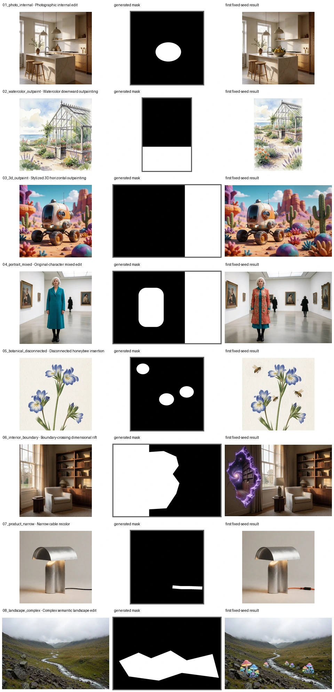

# ComfyUI Krea 2 AnyPaint

Native ComfyUI nodes for the
[`yijunwang2/krea2-anypaint`](https://huggingface.co/yijunwang2/krea2-anypaint)
functional adapter. AnyPaint adds arbitrary-mask **inpainting**, **outpainting**,
and mixed **image editing** to Krea 2 Turbo.

[Model and portable Diffusers example](https://huggingface.co/yijunwang2/krea2-anypaint)
| [Interactive ZeroGPU Space](https://huggingface.co/spaces/yijunwang2/krea2-anypaint)
| [Collection](https://huggingface.co/collections/yijunwang2/krea-2-functional-adapters-6a700e9e5c134888d6615a5d)



## Install

```bash
cd ComfyUI/custom_nodes
git clone https://github.com/alexw5702-afk/krea2-anypaint
```

Restart ComfyUI, then place
`krea2_anypaint_rank32.safetensors` in `ComfyUI/models/loras`.

## Requirements

- A current ComfyUI build with native Krea 2 support.
- [`krea2_turbo_int8_convrot.safetensors`](https://huggingface.co/Comfy-Org/Krea-2/blob/main/diffusion_models/krea2_turbo_int8_convrot.safetensors)
  in `ComfyUI/models/diffusion_models`.
- [`qwen3vl_4b_fp8_scaled.safetensors`](https://huggingface.co/Comfy-Org/Krea-2/blob/main/text_encoders/qwen3vl_4b_fp8_scaled.safetensors)
  in `ComfyUI/models/text_encoders`.
- [`qwen_image_vae.safetensors`](https://huggingface.co/Comfy-Org/Krea-2/blob/main/vae/qwen_image_vae.safetensors)
  in `ComfyUI/models/vae`.
- [Krea 2 AnyPaint LoRA](https://huggingface.co/yijunwang2/krea2-anypaint/blob/main/krea2_anypaint_rank32.safetensors).

No custom sampler and no final source composite are required.

## Nodes

### Krea2 AnyPaint Prepare

Takes a source image, optional arbitrary mask, and four padding values. White
mask pixels and all padded canvas pixels are generated; black pixels are
preserved. The node outputs:

- a 384px semantic reference for Krea 2 reference attention and Qwen3-VL;
- the full-resolution known canvas;
- generated and preserved masks;
- aligned canvas dimensions.

Use the `MASK` output from ComfyUI's `Load Image` Mask Editor directly. For
inpainting, keep all padding at zero. For outpainting, add space on any side.
Both can be combined in one request.

### Krea2 AnyPaint Encode

Encodes the prompt/reference and returns a standard ComfyUI `LATENT` containing
the known image plus a token-aligned `noise_mask`. ComfyUI's sampler applies the
same timestep-matched preservation used by the Diffusers reference pipeline:

```text
known_at_sigma = sigma * initial_noise + (1 - sigma) * known_latent
```

### Krea2 AnyPaint Model Patch

Registers the semantic reference over the complete target grid and precomputes
its isolated reference K/V cache. Connect this node after `Load LoRA` and before
`KSampler`.

## Workflow

Drag [`krea2_anypaint_workflow.json`](krea2_anypaint_workflow.json) into
ComfyUI. The important wiring is:

```text
Load Image (image + mask) -> AnyPaint Prepare
AnyPaint Prepare + CLIP + VAE -> AnyPaint Encode
Load Diffusion Model -> Load LoRA -> AnyPaint Model Patch -> KSampler
AnyPaint Encode.latent -> KSampler.latent_image
KSampler -> VAE Decode -> Save Image
```

Recommended Krea 2 Turbo settings: 8 steps, Euler, simple scheduler, CFG 1.0,
LoRA strength 1.0, VLM reference enabled, K/V cache enabled.

This graph was validated end to end with the three linked Comfy-Org model
files. The preprocessing, mask convention, reference placement, sigma schedule,
and per-step known-region replacement match the Diffusers example and the
DeepMachine backend. Quantized runtimes may differ at the pixel level from the
portable BF16 example.

The output is the raw model decode. Do not add the old registered-outpaint
composite node: AnyPaint preserves known pixels during every denoising step.

## Credits

Reference-attention and K/V-cache code is adapted from
[`RealRebelAI/ComfyUI-Rebels-Krea2-Outpaint`](https://github.com/RealRebelAI/ComfyUI-Rebels-Krea2-Outpaint)
and [`ostris/ComfyUI-Krea2-Ostris-Edit`](https://github.com/ostris/ComfyUI-Krea2-Ostris-Edit).
See `NOTICE` for the complete attribution chain.

Node code is MIT licensed. The separately downloaded LoRA is a Krea 2
derivative and remains subject to the Krea 2 Community License.
